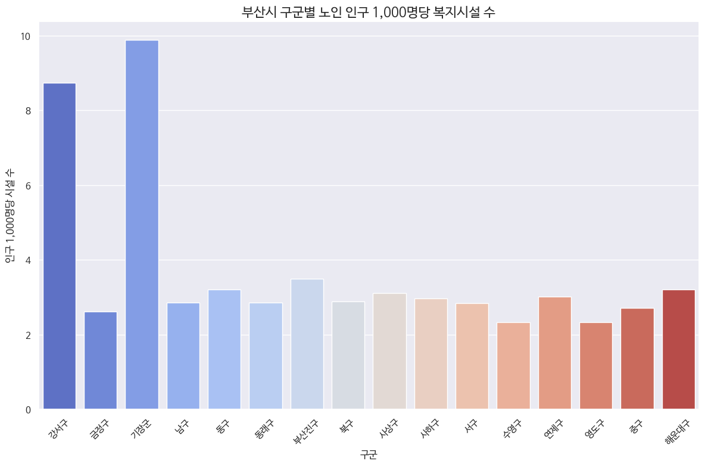

# 부산 노인복지시설 입지 분석

> 인구 수요와 시설 공급, 교통·의료 접근성, 부동산 비용을 결합해 노인복지시설의 입지 후보를 비교했습니다.

[포트폴리오로 돌아가기](../README.md) · [입지 점수 데이터](busan-elderly-facility/final-score.csv)

| 항목 | 내용 |
| --- | --- |
| 시기 | 2025년 1학기 · 데이터과학입문 Term Project |
| 역할 | 개인 프로젝트 · 데이터 전처리부터 입지 점수 설계·후보 선정·시각화까지 수행 |
| 분석 대상 | 부산 16개 구·군, 읍면동 대표좌표에서 생성한 **H3 해상도 9의 대표 격자 203개** |
| 주요 기술 | Python, pandas, NumPy, GeoPandas, H3, Haversine 거리, Kakao Local API, Matplotlib, Seaborn, Folium |
| 결과물 | 시설 유형별 입지 점수 CSV, 분포·접근성 비교 그래프, Folium 입지·후보 지도 |

## 1. 문제와 목표

노인복지시설의 입지를 비교하려면 고령 인구뿐 아니라 기존 시설의 분포와 이용 여건을 함께 살펴봐야 합니다. 복지관·노인교실·경로당처럼 방문하는 시설과 요양시설처럼 거주하는 시설은 중요하게 볼 요소도 다릅니다.

이용형과 주거형 시설을 구분해 입지 조건을 비교하는 점수를 설계했습니다. 수요와 기존 시설과의 거리, 교통·의료 인프라, 비용을 함께 고려해 후보를 탐색했습니다.

## 2. 수행한 작업

- **데이터 통합:** 인구 통계와 네 종류의 노인복지시설 현황, 버스·지하철·의료시설, 부동산 거래 자료의 컬럼과 단위를 정리했습니다.
- **좌표 변환과 공간 집계:** Kakao Local API로 주소를 위도·경도로 변환하고, 읍면동 대표좌표를 H3 격자로 묶었습니다.
- **탐색적 분석:** 구·군별 고령 인구 대비 시설 수, 시설 유형별 최근접 교통·의료시설 거리, 가구 구성과 부동산 가격 분포를 비교했습니다.
- **점수 설계와 후보 비교:** 수요·공급·접근성·경제성을 정규화하고, 시설 유형별 가중치를 적용해 후보 순위를 계산했습니다.
- **시각화:** 분포 그래프와 Folium 지도를 통해 점수의 공간적 분포와 후보 위치를 표현했습니다.

## 3. 데이터와 분석 흐름

| 데이터 | 분석에 활용한 내용 |
| --- | --- |
| 가구 유형별 인구 통계 · 2022.08 | 65세 이상 인구와 가구 형태를 이용한 수요 계산 |
| 노인복지관·노인교실·노인요양시설·경로당 현황 · 2023–2024 | 이용형·주거형 구분, 기존 시설과의 거리 계산 |
| 버스 정류장·지하철역 정보 | 최근접 대중교통 접근성 계산 |
| 병원·약국 정보 | 최근접 의료시설 접근성 계산 |
| 상업·업무용 부동산 매매 자료 · 2020.06–2025.05 | 근린생활시설의 제곱미터당 평균 매매가를 비용 대리지표로 활용 |

읍면동 단위로 집계된 인구에 대표좌표를 부여한 뒤, 해당 좌표가 속한 H3 셀에 인구를 합산했습니다. 시설 접근성은 각 셀의 중심에서 가장 가까운 시설까지의 Haversine 직선거리로 계산했습니다.

## 4. 분석에서 내린 판단

### 시설 수의 비율과 절대 수요를 함께 확인

강서구와 기장군의 노인 인구 1,000명당 시설 수는 각각 약 8.74개와 9.88개로, 다른 구·군보다 높았습니다. 이 두 지역의 포함 여부에 따라 노인 인구와 시설 비율의 상관관계 방향도 달라졌습니다. 단순히 시설 비율이 낮은 지역을 고르는 대신, 고령 인구의 절대 규모와 시설 유형별 분포를 함께 반영했습니다.

### 시설 목적에 따른 평가 기준 설정

| 평가 항목 | 계산 기준 | 이용형 가중치 | 주거형 가중치 |
| --- | --- | --- | --- |
| 수요 | 65세 이상 인구 합계, 1인 가구 인구에 1.5배 가중 | 40% | 10% |
| 공급 공백 | 동일 유형의 기존 시설까지 거리가 멀수록 높은 점수 | 20% | 40% |
| 접근성 | 지하철·버스·의료시설까지 거리가 가까울수록 높은 점수 | 30% | 30% |
| 경제성 | 제곱미터당 평균 매매가가 낮을수록 높은 점수 | 10% | 20% |

각 항목은 Min–Max 방식으로 0–1 범위에 정규화했습니다. 접근성 내부 가중치는 **지하철 40%, 의료시설 40%, 버스 20%**로 설정했습니다. 

가중치는 방문형 시설의 수요·접근성과 거주형 시설의 공급 공백을 강조하기 위해 직접 설정하였고, 이용 실적이나 실제 개설 성과에서 학습한 값은 아닙니다.

## 5. 결과와 입지 후보

**203개 대표 격자에 대해 두 시설 유형의 점수 406개를 산출하고, 점수 지도와 후보 지도를 구성했습니다.** 아래는 저장된 `final_score.csv`를 점수 내림차순으로 정렬한 상위 후보입니다. 점수는 이 결과 안에서의 상대적 비교값입니다.

| 시설 유형 | 점수 순위 | 대표 위치 | 점수 |
| --- | --- | --- | --- |
| 이용형 | 1 | 기장군 대청로 | 0.791 |
| 이용형 | 2 | 북구 금곡동 | 0.699 |
| 이용형 | 3 | 연제구 과정로208번길 | 0.664 |
| 주거형 | 1 | 강서구 성북동 | 0.730 |
| 주거형 | 2 | 기장군 철마로 | 0.665 |
| 주거형 | 3 | 해운대구 해운대해변로 | 0.624 |

원본 노트북에서 최종 선정한 주거형 후보는 강서구 성북동·해운대구 해운대해변로·금정구 구서동입니다. 최종 선정 목록과 점수 순위는 구분하며, 위 표는 저장된 점수 기준입니다.

시설 유형에 따라 상위 후보가 달라졌습니다. 입지의 평가 목적에 맞춰 수요·공급·접근성의 비중을 정하고 그 근거를 설명하는 경험을 쌓았습니다.

## 자료

- [입지 점수 결과 CSV](busan-elderly-facility/final-score.csv)
- [구·군별 시설 수 그래프](busan-elderly-facility/facilities-per-1000.png)

그래프는 분석 노트북에 저장된 원본 출력입니다. CSV의 주소와 좌표는 대표 위치를 나타냅니다.
