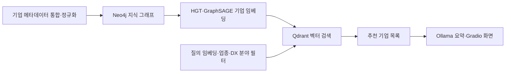

# 지식 그래프 기반 B2B 기업 매칭

> 기업 메타데이터를 지식 그래프로 구조화하고, 벡터 검색과 RAG 요약으로 잠재적 공급·수요 기업을 탐색했습니다.

[포트폴리오로 돌아가기](../README.md) · [팀 최종 발표자료](illunex-b2b-matching/team-final-presentation.pptx)

| 항목 | 내용 |
| --- | --- |
| 기간 | 2025.06–2025.07 |
| 프로젝트 | 일루넥스 × PNU IBA 산학협력 프로젝트 |
| 역할 | 1팀 팀원 |
| 데이터 | 플랫폼 기업 DB **5,305개 기업**의 기본정보·제품·솔루션·특허 등 |
| 개인 담당 | 기업 메타데이터 통합, 텍스트 정규화·파생변수 생성, KG 설계, TF-IDF 유사성 엣지를 통한 GNN 임베딩 보강 |
| 주요 기술 | Python, pandas, Neo4j, TF-IDF, Sentence Transformers, PyTorch Geometric, HGT, GraphSAGE |
| 팀 결과물 | Qdrant 검색과 Ollama·Gradio를 연결한 기업 매칭·RAG 요약 시스템 |

## 1. 문제와 목표

기업의 기술과 제품 정보를 바탕으로 협력 후보를 찾으려면 업종 분류와 함께 기업 간 연관성을 살펴봐야 합니다. 제공된 DB에는 공급·수요 구분이 있었지만, 실제 거래 이력이나 기업 간 관계를 직접 확인할 데이터가 없었습니다. 일부 속성에는 결측값이 많아 단순 항목 비교만으로 매칭하기에도 한계가 있었습니다.

팀은 **보유한 기업 메타데이터에서 잠재적 연관성을 추론하는 것**을 목표로 삼았습니다. 기업·제품·특허·솔루션의 관계를 지식 그래프로 표현하고, 그래프 임베딩을 활용해 협력 후보를 탐색하는 시스템을 구현했습니다.

## 2. 내가 맡은 일

| 담당 업무 | 수행 내용 | 매칭에 필요한 이유 |
| --- | --- | --- |
| 기업 메타데이터 통합 | 기업 기본정보와 관련 메타데이터를 기업 중심으로 통합 | 분산된 속성을 하나의 기업 단위로 연결 |
| 정규화와 파생변수 생성 | 텍스트 표현을 정리하고 범주형 변수를 도출 | 불규칙한 표현을 분석과 그래프 구성에 활용 |
| 지식 그래프 설계 | 기업·제품·특허 등 **9개 노드 유형**과 관계 구조 설계 | 기업의 속성과 연결 정보를 함께 표현 |
| 기업 유사성 엣지 구성 | TF-IDF와 코사인 유사도로 기업 간 연결을 구성해 GNN 임베딩 보강 | 공통 키워드를 가진 기업의 정보를 학습에 반영 |

검색·요약 인터페이스와 아래의 그래프 학습 결과는 팀 결과물입니다.

## 3. 기업 데이터에서 매칭까지

**데이터 전처리:** 팀은 기업 기본정보와 인증·수상·제품·솔루션 시트를 통합하고, 계속사업자를 대상으로 데이터를 정리했습니다. 결측값·특수값 처리와 텍스트 정규화, 주소에서 지역 정보 추출, 리스트 형태 문자열 파싱, 키워드 기반 특허·솔루션 범주 추론을 수행했습니다.

**지식 그래프와 임베딩:** 기업을 중심으로 키워드, DX 분야, 제품, 특허, 솔루션, 지역, 산업분류, 재무정보를 연결하는 구조를 설계했습니다. 기업별 키워드의 TF-IDF 코사인 유사도가 0.3을 초과하는 후보에서 기업별 상위 10개 연결을 구성했습니다. 팀은 이종 관계를 처리하는 HGT와 기업 간 유사성 관계를 처리하는 GraphSAGE의 출력을 결합해, 정규화된 **768차원 기업 벡터**를 생성했습니다.

**검색과 RAG 요약:** 기업 벡터와 속성을 Qdrant에 저장하고, 업종·DX 분야·공급기업 여부 등의 필터를 적용했습니다. Gradio 화면에서는 산업과 솔루션을 선택하고 검색어를 입력하면 후보 기업과 유사도 점수를 보여줍니다. Ollama의 **Gemma 3 4B**는 검색된 기업 정보를 문맥으로 받아 특징과 적합성을 요약합니다.

## 4. 팀 결과물

| 결과물 | 구현 범위 |
| --- | --- |
| 기업 지식 그래프 | **9개 노드 유형, 34,906개 노드, 49,092개 관계** — 최종 발표자료 기준 |
| 그래프 학습 | HGT·GraphSAGE 결합 모델과 768차원 기업 임베딩 |
| 벡터 검색 | Qdrant 기반 유사 기업 검색과 속성 필터링 |
| 검색 화면 | 산업·솔루션·검색어 입력, 추천 기업 목록과 유사도 표시 |
| RAG 요약 | 검색 결과에 근거한 Ollama 요약을 Gradio 화면에 제공 |

팀은 KG 구축, 임베딩 학습, Qdrant·Ollama 연계, 인터페이스 실행을 위한 노트북과 최종 발표자료를 제출했습니다.

## 5. 데이터 분석 관점에서의 의미

**불완전한 기업 정보를 노드와 관계로 표현**해 기업 임베딩과 검색의 입력으로 연결했습니다.

특히 TF-IDF 기반 유사성 연결을 그래프 학습에 반영하면서, 속성 정리와 관계 설계가 이후 분석에 미치는 영향을 살펴봤습니다.

## 자료

- [1팀 최종 발표자료](illunex-b2b-matching/team-final-presentation.pptx) — 팀 전체 결과물, 약 67MB로 다운로드 후 확인
