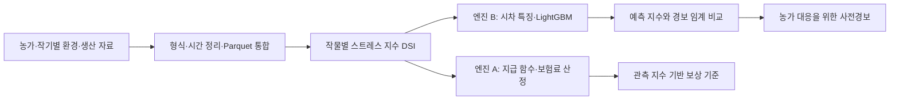

# SmartShield — 스마트팜 지수형 보험·사전경보

> 스마트팜 센서 데이터로 보험료·보상 기준을 산정하고, 별도의 모델로 환경 스트레스를 예측하는 지수형 보험을 설계했습니다.

[포트폴리오로 돌아가기](../README.md) · [GitHub](https://github.com/snorlax914/smart-shield)

| 항목 | 내용 |
| --- | --- |
| 기간 | 2026.04–2026.05 |
| 대회 | 제4회 전국 대학(원)생 리스크관리 경진대회 · 삼성화재 × POSTECH × 서울대학교 |
| 수상 | 장려상 · 2026.05 |
| 역할 | 팀원 · 환경 데이터 파이프라인, 위험 정량화·보험료 산정, 사전경보 모델 개발 |
| 데이터 | 스마트팜 환경 데이터 1,247만 행과 2001–2023년 농작물재해보험 통계 |
| 분석 작물 | 완숙토마토, 방울토마토, 오이, 딸기, 파프리카 |
| 주요 기술 | Python, pandas, NumPy, Parquet, scikit-learn, LightGBM, MLP |
| 팀 결과물 | 지수형 보험 산정·AI 사전경보 설계, 모델링 노트북, 보고서·발표자료 |

## 1. 문제와 목표

스마트팜의 환경 위험을 보험으로 다루려면 센서 관측을 어떤 지표로 만들고 보상과 연결할지 정해야 합니다. 환경 변화와 실제 수확량 손실의 관계가 명확하지 않으면 위험 평가와 보험료 산정도 어렵습니다.

관측 지수에 따른 보상 기준과 AI 사전경보를 분리하는 구조를 제안했습니다. 엔진 A는 관측된 환경 스트레스 지수로 보험료와 보상 기준을 계산합니다. 엔진 B는 미래 환경 스트레스를 예측해 농가의 대응을 돕는 역할입니다. AI 예측값을 보험금 지급 조건으로 사용하지 않는 설계입니다.

## 2. 담당 역할

| 담당 업무 | 수행 내용 |
| --- | --- |
| 데이터 파이프라인 | 1,247만 행 규모 환경 데이터를 처리하는 통합·정제 흐름 구축 |
| 위험 정량화 | 작물별 온도 임계와 환경 관측을 결합해 스트레스 지수 구성 |
| 보험료 산정 | 위험지수의 분포와 지급 함수를 연결한 보험료 계산 |
| 사전경보 모델 | 슬라이딩 윈도우 특징을 구성하고 LightGBM 기반 7일 경보 모델 개발 |
| 모델 평가 | 시간 순서를 고려한 검증 구간 구성, 기준선·MLP와 비교 |

보험 상품의 사업 전략과 단계별 실증 계획은 팀 제안입니다.

## 3. 데이터에서 이중 엔진까지

### 데이터 통합과 손해 지표

로컬 분석 노트북에는 124개 CSV를 5개 Parquet으로 통합하는 과정이 포함돼 있습니다. 파일 인코딩과 날짜·수치 형식을 정리하고, 연도·지역·농가·품목·작기를 공통 키로 사용해 환경 자료와 생산 자료를 연결했습니다.

분석 초기에는 환경 변수와 수확량의 관계, 출하 패턴 등을 손해 지표로 검토했습니다. 최종 설계에서는 작물별 고온·저온 임계 초과를 1:3:10 가중치로 합산한 DSI(Damage Stress Index)를 사용했습니다. 출하가 끝나야 계산되는 지표와 사전에 관측할 수 있는 지표를 구분하는 것이 중요한 판단이었습니다.

### 엔진 A — 관측 지수와 보험료

작물별 농가·작기 평균 DSI의 90·99번째 경험분위를 지급 시작점과 최대 지급점으로 설정했습니다. 두 임계 사이에서는 피해율이 선형적으로 증가하고, 범위 밖에서는 0–1로 제한되는 지급 함수를 구성했습니다.

보험료는 경험분포에서 계산한 평균 피해율 × 기준 매출 × 보장률 0.7 × 안전할증 1.4로 산정했습니다.

### 엔진 B — 환경 스트레스 예측과 경보

공개 코드는 환경·DSI 변수 13개의 시차 3개로 39개 특징을 만들고, 현재 시점 변수 11개와 시간 변수 2개를 더해 총 52개 특징을 구성합니다. LightGBM 회귀 결과를 별도의 경보 임계값과 비교해 경보 여부로 변환합니다. MLP와 직전 관측값을 유지하는 Persistence 기준선도 비교합니다.

7일 사전경보 모델의 예측 대상은 이후 관측값을 이동평균한 DSI입니다. 학습에는 2020–2022년을, 검증과 조기 종료에는 2023년 자료를 사용했습니다.

## 4. 보고서의 결과

### 작물별 사전경보 성능

아래는 최종 보고서의 2023년 검증 수치입니다.

| 작물 | Persistence R² | LightGBM R² | LightGBM MAE | 경보 F1 |
| --- | --- | --- | --- | --- |
| 완숙토마토 | 0.281 | 0.498 | 1.92 | 61% |
| 방울토마토 | 0.298 | 0.461 | 2.41 | 68% |
| 오이 | 0.124 | 0.252 | 2.65 | 42% |
| 딸기 | 0.287 | 0.491 | 2.18 | 56% |
| 파프리카 | 0.245 | 0.443 | 2.07 | **74%** |

보험금 지급과 사전경보에는 각각의 목적에 맞는 임계값을 적용했습니다.

### 보험 설계와 실증 제안

보고서의 작물별 보험료율은 4.14–6.78%의 잠정 산출값입니다. 실제 손해·보험금 자료를 이용해 해당 상품의 요율 적정성을 입증한 결과와는 구분합니다. 팀은 파프리카를 대상으로 경보 농가군과 통제군을 비교하는 후속 PoC를 제안했습니다.

이 프로젝트는 장려상을 수상했습니다. 피해율 감소, 농가 소득 안정화, 자동 지급의 실사용 효과는 시나리오 또는 향후 검증 항목입니다.

## 5. 데이터 분석 관점에서의 의미

환경·생산 자료를 통합하고, 위험지수와 보험료 산정, 시계열 모델로 연결했습니다. 이 과정에서 위험을 어떻게 정의하고 언제 알 수 있는 정보를 사용할지 판단했습니다.

보험금 지급과 사전경보의 목적을 분리하고 각기 다른 임계값을 적용했습니다. 이를 통해 데이터의 시간축과 평가 대상이 일치하는지 확인하는 경험을 쌓았습니다.

## 자료

- [공개 저장소](https://github.com/snorlax914/smart-shield)
- [검토한 모델링 노트북](https://github.com/snorlax914/smart-shield/blob/28b696942e982f5a53834e34e7eac837a09119c8/SmartShield_%EB%AA%A8%EB%8D%B8%EB%A7%81.ipynb)
- [최종 영문 보고서](smart-shield/final-report.docx)
- [팀 발표자료 PDF](smart-shield/team-presentation.pdf)
